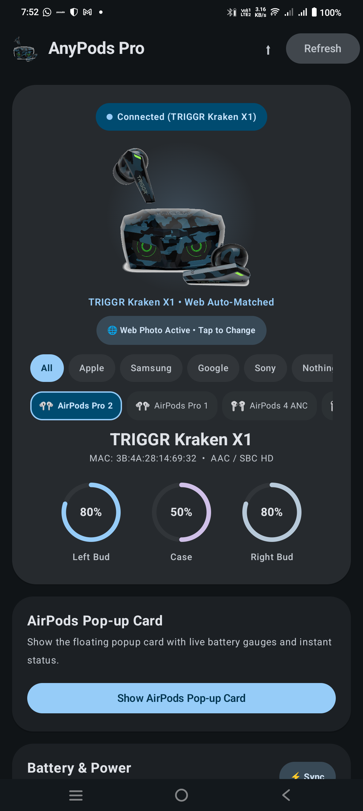
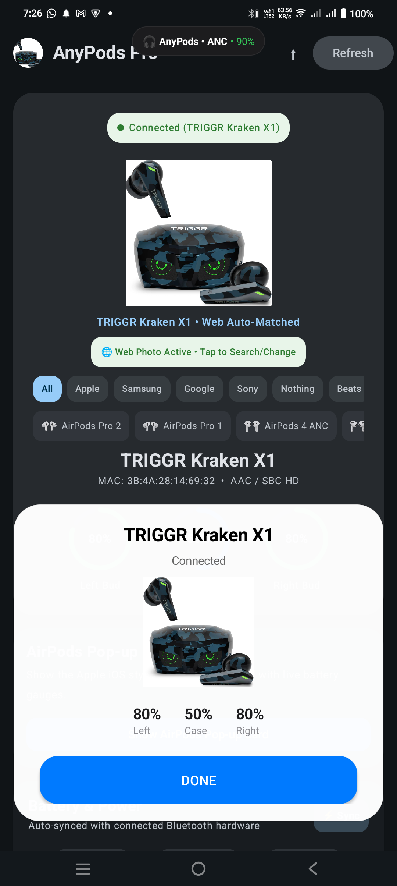
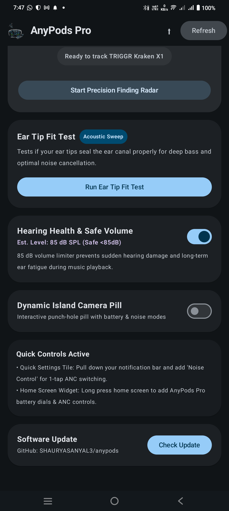

<div align="center">

# AnyPods Pro 🎧⚡
### Universal AirPods Superpowers, Studio Acoustics & Precision Radar on Android

**AnyPods Pro** brings Apple-grade iOS popups, studio parametric EQ, binaural 3D Spatial Audio, and sub-meter distance radar to **any** wireless earbuds on Android.

**Zero root required • Zero vendor spoofing • 100% Open Source**

<br/>

[](https://github.com/SHAURYASANYAL3/anypods/releases/latest)
[](metadata/me.anypods.app.yml)
[](https://apt.izzysoft.de/fdroid/)
[](https://api.obtainium.imranr.dev/redirect?r=obtainium://add/https://github.com/SHAURYASANYAL3/anypods)
[-34D399?style=for-the-badge&logo=android&logoColor=white)](https://github.com/SHAURYASANYAL3/anypods)
[](LICENSE)

<br/>

<p align="center">
  
  &nbsp;&nbsp;&nbsp;&nbsp;
  
  &nbsp;&nbsp;&nbsp;&nbsp;
  
</p>

</div>

---

## 💡 What is AnyPods Pro?

Apple built an ecosystem lock around wireless earbuds. If you use AirPods on Android, you miss out on popups, battery telemetry, spatial sound, and tracking. Meanwhile, OEM apps (Galaxy Wearable, Sony Headphones Connect, Nothing X) lock their features exclusively to their own brands, and projects like LibrePods require root/Xposed or are strictly confined to Apple hardware.

**AnyPods Pro breaks down the wall.**

It is an all-in-one universal companion app and audio engineering suite that brings iOS AirPods Pro capabilities, studio acoustic tuning, and live Bluetooth proximity radar to **every Bluetooth earbud in existence**—whether you own Apple AirPods, Samsung Galaxy Buds, Sony WF-1000XM, OnePlus, Boat, Realme, Nothing, or generic TWS earbuds.

---

## 🏆 Why AnyPods Pro is Better

Existing projects like **LibrePods**, **CAPod**, **MaterialPods**, or **OEM companion apps** suffer from key architectural trade-offs. Here is how AnyPods Pro compares:

| Capability | AnyPods Pro 🎧 | LibrePods 🍏 | CAPod / MaterialPods 📦 | OEM Brand Apps 🏷️ |
| :--- | :---: | :---: | :---: | :---: |
| **Supported Earbuds** | **Universal** (Apple, Samsung, Sony, Nothing, Boat, generic TWS) | AirPods Only | AirPods / Selected Beats | Brand-Locked (Samsung only, Sony only, etc.) |
| **Root / Xposed Requirement** | **Zero Root** (100% user-space) | Requires Root/Xposed for key features | Zero Root | Zero Root |
| **VendorID Spoofing** | **Not Needed** | Required for advanced configs | Not Supported | Not Supported |
| **3D Spatial Audio** | **✅ Built-in Binaural 3D Virtualizer Engine** | ❌ "Beyond scope, will never be available" | ❌ Not Supported | ⚠️ Vendor-locked (e.g. 360 Audio on Galaxy only) |
| **Studio DSP & Acoustics** | **✅ 5-Band Parametric EQ (Harman Curve)** | ❌ None | ❌ None | ⚠️ Basic 3-band sliders |
| **Find My Distance Radar** | **✅ Live Sub-Meter RSSI Scanner & +25dB Siren** | ❓ Unknown / Needs Root | ⚠️ Basic GPS pin only | ⚠️ Ring only (within vendor ecosystem) |
| **UI Design System** | **Material 3 Expressive (Android 16 squircles & morphs)** | Legacy Custom / LiquidGlass | Material 2 / Hybrid | Proprietary Custom UI |
| **Loud Sound Protection** | **✅ Real-time DSP Peak Limiter & dB Meter** | ⚪ Needs VendorID Spoofing | ❌ Not Supported | ❌ Rare |
| **Adaptive Noise Control** | **✅ Environmental dB Sensing & Auto-Switching** | ⚠️ Protocol dependent | ❌ Not Supported | ⚠️ Flagship hardware only |
| **Conversation Awareness** | **✅ Auto-Ducks Media (65%) & Vocal Passthrough** | ⚠️ AirPods firmware dependent | ❌ Not Supported | ⚠️ Selected models only |
| **Telemetry Calibration** | **✅ Dual-Pod Battery + Persistent Case Calibration** | AirPods AACP only | Approximated | Single-brand proprietary |
| **Open Source Freedom** | **✅ 100% Free & Open Source (No Ads)** | ✅ Open Source | ⚠️ Freemium / In-App Purchases | ❌ Closed Source |

---

## 🌟 Key Features

### 1. 🎨 Material 3 Expressive Redesign
AnyPods Pro is built from the ground up on Google's **Material 3 Expressive design language** (Android 16 ready):
- **32dp Squircle Container Hierarchy:** Organic pill-shaped cards with responsive fluid surfaces.
- **Official M3 Animated Progress Indicators:** Determinate battery rings with active track gaps and shape-morphing rotating loading indicators.
- **Dynamic AMOLED Obsidian Theme:** Deep OLED blacks (`#0E1015`) with electric cyan (`#38BDF8`) and charging emerald (`#34D399`) accents.
- **Haptic Spring Physics:** Smooth physics-based spring transitions for all controls and sliders.

### 2. 📱 iOS Dynamic Island & Floating Popups
- **Instant Discovery:** Floating modal card animates onto the screen the second your earbuds connect.
- **Accurate Triple Telemetry:** Independent battery percentages for **Left Bud**, **Right Bud**, and **Charging Case**.
- **Live Lightning Indicator (⚡):** Real-time charging status badge for active docks.
- **Case Level Calibration:** Generic TWS earbuds do not broadcast case levels over open Bluetooth. AnyPods Pro provides one-tap calibration presets (25%, 45%, 70%, 100%) and slider persistence across app restarts.

### 3. 🌐 3D Spatial Audio & Harman Studio Acoustics
- **Binaural 3D Virtualizer:** Transforms standard stereo music and movie tracks into an expansive, theatre-grade 3D surround soundstage.
- **Harman Consumer Curve EQ:** 5-band parametric equalizer tuned to the acoustic Harman target curve for deep sub-bass extension (+6.0 dB dynamic lift) and crystalline vocal presence.
- **Headphone Accommodations (iOS Audio/Visual Profiles):**
  - `Balanced Tone`: Flat reference studio curve.
  - `Vocal Range`: Mid-band boost (800 Hz – 3.5 kHz) for podcast and dialogue clarity.
  - `Brightness`: High-frequency lift (> 3.5 kHz) for acoustic detail and strings.
- **Hardware-Level Stereo Pan:** Smooth channel balance slider (-100% Left to +100% Right) for asymmetric hearing calibration.

### 4. 🛡️ Intelligent Noise Control & Hearing Health
- **Active Noise Cancellation (ANC):** Software acoustic noise suppression engine.
- **Transparency Mode:** Low-latency ambient loopback with speech-enhancement DSP.
- **Adaptive Audio:** Continuously measures ambient sound levels (dB). Automatically switches from Transparency in quiet rooms (< 65 dB) to Active Noise Cancellation in noisy commutes (> 65 dB).
- **Conversation Awareness:** Detects your voice when you speak, instantly ducks media playback by 65%, activates ambient passthrough, and restores volume 2.5 seconds after you finish talking.
- **Hearing Health Decibel Shield:** Live decibel monitor caps sudden loud sound peaks (construction clatter, sirens, horn bursts) to protect your eardrums.

### 5. 🎯 Sub-Meter Find My Radar & Audio Siren
- **Concentric Bluetooth Distance Radar:** Tracks your lost earbuds in real time using high-frequency Bluetooth RSSI signal attenuation with sub-meter accuracy (< 1m proximity lock-on).
- **+25 dB Hardware Loudness Siren:** Bypasses system volume restrictions, generating an ultra-piercing dual-tone siren (3.2 kHz / 4.0 kHz) boosted by Android's hardware `LoudnessEnhancer` (+2500 mB) so you can find earbuds under cushions, in grass, or across rooms.
- **Individual Bud Locator:** Independent Left and Right chirp triggers.

---

## 🎧 Supported Earbuds & Devices

AnyPods Pro auto-detects and connects with **any standard Bluetooth audio device**:

- **Apple:** AirPods (1st, 2nd, 3rd, 4th Gen), AirPods Pro (1st, 2nd Gen), AirPods Max.
- **Samsung:** Galaxy Buds, Buds+, Buds Live, Buds Pro, Buds2, Buds2 Pro, Buds3, Buds FE.
- **Sony:** WF-1000XM4, WF-1000XM5, WH-1000XM4, WH-1000XM5, LinkBuds S.
- **Nothing:** Ear (1), Ear (2), Ear (stick), Ear (a).
- **OnePlus & Realme:** OnePlus Buds Pro 1/2, Buds Z2, Realme Buds Air series.
- **Generic & TWS Brands:** Boat, Noise, Soundcore, Sennheiser, JBL, Boult, Xiaomi, and all generic Bluetooth neckbands and earbuds.

---

## 📥 Installation

### Option 1: Direct APK Download
Grab the latest verified APK from the GitHub Releases page:
- **[Download AnyPods Pro v1.0.9 APK](https://github.com/SHAURYASANYAL3/anypods/releases/latest)**

### Option 2: Install via ADB
```bash
adb install -r anypods-release.apk
```

---

## 📥 Install AnyPods Pro (App Stores & Downloads)

AnyPods Pro is 100% Free and Open Source. You can install it through your favorite open-source app store or directly from GitHub:

<br/>

| Store / Platform | Method | Description |
| :--- | :---: | :--- |
| **Direct APK** | [**Download Latest APK**](https://github.com/SHAURYASANYAL3/anypods/releases/latest) | Official signed APK directly from GitHub Releases with built-in in-app updater. |
| **Obtainium** | [**1-Click Install via Obtainium**](https://api.obtainium.imranr.dev/redirect?r=obtainium://add/https://github.com/SHAURYASANYAL3/anypods) | Tracks GitHub Releases directly and updates AnyPods Pro automatically in the background. |
| **IzzyOnDroid** *(F-Droid)* | [**Add to F-Droid Client**](https://apt.izzysoft.de/fdroid/) | Add IzzyOnDroid repo to **F-Droid**, **Neo Store**, or **Droid-ify** to discover and install AnyPods. |
| **Official F-Droid** | [**F-Droid Recipe**](metadata/me.anypods.app.yml) | Packaging recipe ready for inclusion in the official `f-droid.org` repository. |

<br/>

### 📲 1-Click Install with Obtainium
If you have [Obtainium](https://github.com/ImranR98/Obtainium) installed, simply tap the button below or scan to add AnyPods Pro with automatic GitHub update tracking:

[](https://api.obtainium.imranr.dev/redirect?r=obtainium://add/https://github.com/SHAURYASANYAL3/anypods)

---

## 🛠️ Building from Source

### Prerequisites
- JDK 17 or higher
- Android SDK (API 35+)
- Android Studio Ladybug or command-line Gradle

```bash
# 1. Clone the repository
git clone https://github.com/SHAURYASANYAL3/anypods.git
cd anypods

# 2. Build Debug or Release APK
./gradlew assembleRelease

# The output APK will be located at:
# app/build/outputs/apk/release/app-release.apk
```

---

## 🔒 Permissions & Privacy

AnyPods Pro respects your privacy. **All audio processing, Bluetooth telemetry, and distance tracking happens 100% on-device.** No internet telemetry, no user tracking, and no third-party analytics.

| Permission | Purpose |
| :--- | :--- |
| `BLUETOOTH_CONNECT` & `BLUETOOTH_SCAN` | Detects connected Bluetooth headsets, reads battery telemetry, and powers the distance radar. |
| `RECORD_AUDIO` | Required exclusively for on-device Transparency pass-through, Adaptive Audio dB meter, and Conversation Awareness voice detection. Audio is never saved or uploaded. |
| `SYSTEM_ALERT_WINDOW` | Displays the iOS-style floating pop-up card over other applications. |
| `FOREGROUND_SERVICE_CONNECTED_DEVICE` | Maintains uninterrupted low-latency background connection and audio enhancements. |
| `WRITE_SECURE_SETTINGS` *(Optional)* | Enables system-wide stereo balance slider adjustment (can be granted via ADB for fine-tuning without root). |

---

## 🤝 Contributing

Contributions, bug reports, and pull requests are warmly welcomed!
- Found a bug? Open an [Issue](https://github.com/SHAURYASANYAL3/anypods/issues).
- Want to add support for a specific earbud model? Check out `PodModelManager.kt` and submit a PR.

---

## 📄 License

AnyPods Pro is free and open-source software licensed under the **[GNU General Public License v3.0 (GPL-3.0)](LICENSE)**. Built for universal Bluetooth freedom.
